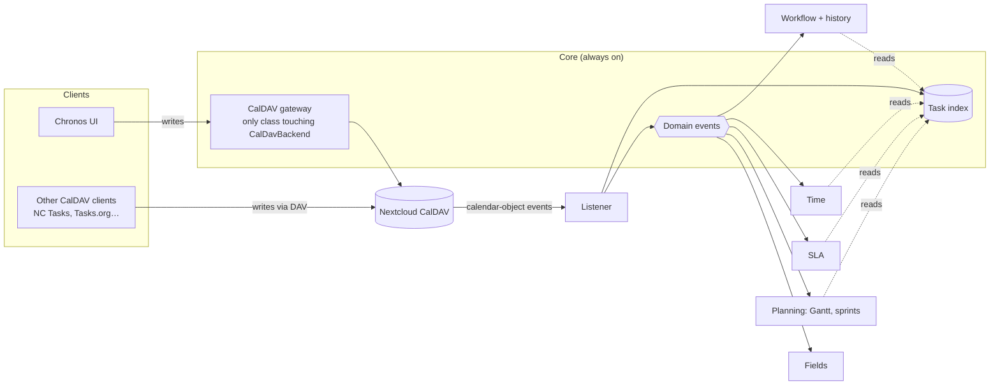

# Chronos — Architecture

> **Status:** living document · October 2026 · M1 implemented (v0.2.0)
>
> Describes the target architecture for growing Chronos from a time tracker into a project-management
> app built on Nextcloud Tasks (CalDAV VTODO), and the roadmap to get there.
>
> M1 is built; §17 records what it fixed and what it found. Everything from M2 onwards is still design.

## Contents

1. [Goals](#1-goals)
2. [Principles](#2-principles)
3. [Decision log](#3-decision-log)
4. [Requirements](#4-requirements)
5. [Coupling: hub and spoke](#5-why-everything-is-linked-doesnt-mean-everything-is-coupled)
6. [Hierarchy](#6-hierarchy)
7. [VTODO property mapping](#7-vtodo-property-mapping)
8. [Time, dates and units](#8-time-dates-and-units)
9. [Module map](#9-module-map)
10. [Data model](#10-data-model)
11. [Event flow](#11-event-flow)
12. [Modules in detail](#12-modules-in-detail)
13. [Feature toggles](#13-feature-toggles)
14. [Code structure and conventions](#14-code-structure-and-conventions)
15. [Interaction design: drag and drop](#15-interaction-design-drag-and-drop)
16. [Performance](#16-performance)
17. [Current technical debt](#17-current-technical-debt)
18. [Testing strategy](#18-testing-strategy)
19. [Risks](#19-risks)
20. [Roadmap](#20-roadmap)
21. [Open questions](#21-open-questions)
22. [Glossary](#22-glossary)

---

## 1. Goals

Chronos should cover, inside **one** Nextcloud app:

- **Projects → subprojects → tasks → subtasks**, built on regular Nextcloud Tasks lists
- **Custom workflows** (statuses) with a **kanban** whose columns *are* those statuses
- **Gantt and roadmap** with dates, dependencies and milestones
- **Time tracking** (what Chronos does today), per project *and* per task
- **Assignment, time-in-state and SLAs** (GLPI-style)
- **Custom fields**, **sprints** and an **Eisenhower matrix**

…while every change stays visible to other CalDAV clients (Nextcloud Tasks, Nextcloud Calendar,
DAVx5 → Tasks.org).

**Non-goals:** replacing Nextcloud Calendar for events; a native mobile app (the phone uses CalDAV clients
and the web UI); billing/invoicing.

## 2. Principles

0. **One task, many views.** The Tasks app, the list, the kanban, the Gantt, the roadmap and the phone all
   show *the same task object*. Changing a date in the Gantt or a status in the kanban edits that one
   object; every other view re-reads it. There is never a second copy to keep in sync by hand.
1. **CalDAV is the source of truth for tasks.** Every task is a real VTODO. Chronos never keeps a private
   copy of a task that other clients can't see.
2. **Chronos stores only what CalDAV can't.** Workflows, field definitions, SLA policies, sprints, time
   sessions and history live in Chronos tables, keyed by task UID or list URI.
3. **Standard properties first.** If iCalendar has a property for it, use it. `X-CHRONOS-*` only for the rest.
4. **Hub and spoke, not a mesh.** All modules depend on one shared core; no module reads another module's
   tables (§5).
5. **Every module is optional.** Feature toggles turn modules on and off; the core works with all of them off.
6. **One unit of time.** All stored timestamps and durations are **UNIX seconds** (§8).
7. **Thin synchronous path, heavy work in background jobs.**
8. **Interactions feel direct.** Anything draggable moves at frame rate, snaps predictably and saves
   without the user waiting (§15).

## 3. Decision log

| # | Decision | Alternatives considered | Reason |
|---|---|---|---|
| AD1 | Build on Nextcloud Tasks (CalDAV VTODO) as the task store | Own task tables; Vikunja/Leantime/Plane | Phone sync and Calendar integration for free; no duplicate task data |
| AD2 | Grow the existing Chronos app instead of a new app | New app; fork Vikunja | Chronos already uses Tasks lists as projects; time tracking done |
| AD3 | One modular app with feature toggles | Several apps (`chronos-sla`, `chronos-planning`…) | No inter-app APIs or version matrices; toggles give the same separation |
| AD4 | Hub and spoke: core index + domain events | Modules calling each other | Linked behaviour without coupling (§5) |
| AD5 | **UNIX seconds** for all stored times and durations | Milliseconds (current code) | Matches Nextcloud (`ITimeFactory`, jobs, CalDAV tables) and iCalendar's one-second resolution; ms only helps JavaScript, handled at the API boundary (§8) |
| AD6 | `OCP\AppFramework\Utility\ITimeFactory` as the only source of "now" | Custom `Clock` class; `time()`/`microtime()` calls | Public, mockable Nextcloud API |
| AD7 | Kanban columns = workflow statuses | Separate board/column model (Deck, Vikunja) | Moving a card changes the real status everywhere |
| AD8 | Subproject = container VTODO in the project's list | One list per subproject | Avoids list clutter in every CalDAV client; promotion to a list remains possible |
| AD9 | Gantt dependencies stored as RFC 9253 temporal `RELATED-TO` | Chronos-only link table | Standard, portable; Chronos keeps a parsed copy for queries |
| AD10 | Minimum Nextcloud 32 | Keep 31 with an event adapter | `OCP\Calendar\Events` are public since 32, so the adapter in §11.3 is not needed. 31 and 32 are both end of life; 33–35 are the maintained releases (see Q2) |
| AD11 | Shared lists are a first-class requirement | Single user, sharing later | Assignment between people is wanted, so the index is per user and permissions follow CalDAV sharing from M2 on (see Q1) |
| AD12 | Route-bearing controllers stay directly in `lib/Controller/` | One controller per module directory | Nextcloud discovers attribute routes with a non-recursive `DirectoryIterator` over `lib/Controller`, reflecting `OCA\Chronos\Controller\<File>`. Only the controllers live there; each module keeps its services, mappers and requests (§9) |
| AD13 | One active session per user enforced by a unique index | Transaction and re-check only | A re-check inside a transaction still races under MySQL's default isolation. `chronos_entries.active_user_id` holds the uid while a session runs and NULL afterwards; a unique index over it allows many NULLs on every database in N1, so a second check-in fails at the database (D5) |
| AD14 | Hash routing in the frontend | Path routing with a catch-all backend route | Every view stays inside the app's single server route, so no backend route is needed per view |

## 4. Requirements

### 4.1 Functional

| ID | Requirement | Module | Milestone |
|---|---|---|---|
| F1 | Every Nextcloud Tasks list appears as a project, with no setup | Core | M2 |
| F2 | Areas group projects; subprojects nest inside a project; a subproject can be promoted to its own list | Projects | M2 (areas, subprojects), M4 (promote) |
| F3 | Create, edit, complete and delete tasks and subtasks from any view; changes visible in all views and CalDAV clients | Core | M2 |
| F4 | Custom workflows per project from templates; each status maps to a standard `STATUS` | Workflow | M2 |
| F5 | Optional transition rules: allowed transitions, required comment, required assignee | Workflow | M3 |
| F6 | Kanban whose columns are workflow statuses; drag to change status and order; multi-select drag | Kanban | M3 |
| F7 | Every status and assignee change recorded with who, when and source | Workflow | M2 |
| F8 | Gantt per project/subproject: drag to move, resize, link dependencies; milestones; summary bars | Planning | M4 |
| F9 | Cross-project roadmap grouped by area, drill-down to Gantt | Planning | M4 |
| F10 | Time sessions (check-in, pause, check-out, edit) per project and optionally per task, with rollups | Time | M1 (fixes), M5 (per task) |
| F11 | Goals per project stored server-side | Time | M5 |
| F12 | SLA policies (time to own, time to resolve), business hours, pausing statuses, warning and breach notifications | SLA | M6 |
| F13 | Custom fields (global or per project), filterable; urgency × impact → priority | Fields | M6 |
| F14 | Sprints with burndown and Gantt bands | Planning | M7 |
| F15 | Eisenhower matrix with drag between quadrants | Matrix | M7 |
| F16 | Admin and per-user feature toggles | Core | M1 |
| F17 | Undo for the last drag or bulk action | UI | M3 |
| F18 | Analytics correct over any date range (not limited to recent sessions) | Time | M1 |

### 4.2 Non-functional

| ID | Requirement | Target / rule |
|---|---|---|
| N1 | Compatibility | Nextcloud 32–33, PHP ≥ 8.1, browsers per `@nextcloud/browserslist-config`; MySQL/MariaDB, PostgreSQL and SQLite. Nextcloud 34 and 35 need PHP ≥ 8.2 and ≥ 8.3 respectively, so widening the range is a deliberate step, not a version-number change (Q2) |
| N2 | Drag performance | 60 fps during drag on a mid-range laptop with 500 visible cards or bars |
| N3 | Perceived save latency | UI updated on drop (optimistic); server confirmation < 300 ms on LAN |
| N4 | View load | Kanban or Gantt of a project with 2,000 tasks interactive in < 1 s (warm, from the index) |
| N5 | Listener cost | < 50 ms per calendar-object event; no network calls or heavy work in the listener |
| N6 | Data integrity | No Chronos data lost when a module is disabled or a client strips `X-` properties; every task write uses an etag precondition; every migration is idempotent |
| N7 | Security | Every endpoint scoped to the current user; shared lists follow CalDAV ACLs; CSRF via the Nextcloud request token; all input validated server-side |
| N8 | Accessibility | Every drag action also possible by keyboard; WCAG AA contrast in light and dark themes |
| N9 | Internationalisation | All UI strings via `@nextcloud/l10n`; dates, times and first day of week from the user's locale |
| N10 | Maintainability | Psalm passes at the configured level; PHP classes ≲ 400 lines, Vue components ≲ 300 lines; every service has unit tests |
| N11 | Time correctness | One unit (seconds) everywhere; no DST or off-by-one errors on all-day dates (§8) |
| N12 | Observability | Errors logged with app id and context; reconcile job logs drift counts |

## 5. Why "everything is linked" doesn't mean "everything is coupled"

Every feature touches every other: a status change affects the kanban, the history, the SLA clock, the
timer, the Gantt progress and the sprint burndown. If modules called each other directly, changing any one
of them would ripple through all of them.

Chronos avoids that with **one hub**:



Rules:

- **Modules read** the task index and their own tables.
- **Modules write tasks** only through the core's CalDAV gateway.
- **Modules react** to core domain events (`TaskStatusChanged`, `TaskAssigned`, `TaskDatesChanged`…); they
  don't call each other.
- **A disabled module** registers no listeners, routes or jobs. Nothing else breaks.
- Where one module needs another's data (SLA needs workflow flags; Gantt needs time totals), it uses that
  module's **public service interface** and degrades gracefully when the module is disabled.

## 6. Hierarchy

```
Area (optional)      → Chronos only           Work, Personal, Homelab…
└─ Project           → a VTODO list (calendar supporting VTODO)
   └─ Subproject     → container VTODO   (X-CHRONOS-TYPE:SUBPROJECT)
      └─ Task        → VTODO, RELATED-TO;RELTYPE=PARENT → subproject
         └─ Subtask  → VTODO, RELATED-TO;RELTYPE=PARENT → task
```

- **Project = Tasks list.** Unchanged from today. The project reference keeps the existing format
  `principals/users/<uid>/<calendar-uri>` (`project_uri`), so existing sessions stay linked. A
  `chronos_projects` row is created lazily, only when the project is configured.
- **Subproject = container VTODO** inside the list. Other clients see a parent task with nested children,
  which stays meaningful on the phone. Its UID lets time and progress roll up through it.
- **Promote to list:** moves a large subproject's tasks into a new list; the parent link is kept in
  `chronos_projects.parent_project_id`.
- **Milestone** = VTODO with `X-CHRONOS-TYPE:MILESTONE` and `DUE` only (zero duration).
- A subproject completed in another client is accepted if all children are done; otherwise Chronos reopens
  it and shows a notice.

## 7. VTODO property mapping

| Concept | iCalendar property | Notes |
|---|---|---|
| Title / description | `SUMMARY`, `DESCRIPTION` | |
| Standard status | `STATUS` | `NEEDS-ACTION`, `IN-PROCESS`, `COMPLETED`, `CANCELLED` |
| Workflow status | `X-CHRONOS-STATUS` | status key; Chronos tables are the fallback source of truth |
| Priority | `PRIORITY` | 1–9 (1 = highest), 0 = undefined |
| Start / due | `DTSTART`, `DUE` | value type (DATE vs DATE-TIME), `TZID` or floating form preserved (§8.4) |
| Completion | `COMPLETED`, `PERCENT-COMPLETE` | `COMPLETED` is a UTC DATE-TIME |
| Parent | `RELATED-TO;RELTYPE=PARENT` | on the child, pointing to the parent |
| Gantt dependency | `RELATED-TO;RELTYPE=FINISHTOSTART` (or `STARTTOSTART`, `FINISHTOFINISH`, `STARTTOFINISH`) with optional `GAP=<duration>` | RFC 9253 §4, §6.2: the property is on the **predecessor** and points to the **successor**; positive `GAP` = lag, negative = lead |
| Generic blocker | `RELATED-TO;RELTYPE=DEPENDS-ON` | RFC 9253 §5: on the dependent task, pointing to the task it depends on; not used for scheduling |
| Assignee | `ATTENDEE` | Nextcloud user principal |
| Tags | `CATEGORIES` | |
| Type | `X-CHRONOS-TYPE` | `TASK` (default), `SUBPROJECT`, `MILESTONE` |
| Sprint | `X-CHRONOS-SPRINT` | mirror only |
| Custom fields | `X-CHRONOS-FIELD-<key>` | optional mirror; DB is authoritative |

**Unknown-property risk.** Some clients drop `X-` properties, and possibly RFC 9253 `RELTYPE` values they
don't know, when they rewrite a task. Every such value is also stored in Chronos tables keyed by UID; if a
client strips it, Chronos restores it on its next write and never loses data. This is verified in the M2
spike with DAVx5 + Tasks.org and the NC Tasks app.

**What Chronos itself preserves.** The same courtesy in the other direction: an edit reads the task as it
is, replaces only the properties Chronos manages, and writes it back (`Core/Dav/VTodoWriter`). A
description, a category, a location, an alarm, a recurrence rule, another client's own `X-` property and
every non-parent `RELATED-TO` all survive being edited in Chronos, which is covered by tests. One caveat
seen in practice: re-serialising re-spells a property's default value type, so `URL:…` comes back as
`URL;VALUE=URI:…`. That is the same property under RFC 5545, and no client should read it differently.

## 8. Time, dates and units

### 8.1 Rule

**Every stored timestamp and duration is an integer number of UNIX seconds (UTC).** No milliseconds
anywhere on the server, in the database or in the API.

Reasons (AD5):
- Nextcloud uses seconds: `ITimeFactory::getTime()`, background jobs, and the CalDAV tables Chronos indexes
  (`firstoccurence`, `lastoccurence`, `lastmodified`).
- iCalendar's resolution is one second; `DTSTART`, `DUE` and `COMPLETED` can't carry milliseconds.
- Time tracking, SLAs and scheduling don't need sub-second precision.
- JavaScript's millisecond `Date` is a frontend detail, converted in exactly one place (§8.5).

### 8.2 Naming conventions

| Kind | Suffix | DB type | Example |
|---|---|---|---|
| Point in time | `_at` | `BIGINT` | `start_at`, `due_at`, `changed_at` |
| Duration | `_seconds` | `BIGINT` | `paused_seconds`, `own_target_seconds`, `gap_seconds` |
| Boolean "this timestamp is an all-day date" | `_is_date` | `BOOLEAN` | `start_is_date` |

No column is named `*_time` or `*_ms`. JSON keys follow the same names in camelCase (`startAt`,
`pausedSeconds`).

### 8.3 Source of "now"

- Server: inject `OCP\AppFramework\Utility\ITimeFactory` and call `getTime()` (seconds). No `time()`,
  `microtime()` or `new DateTime()` for "now" in app code. Tests mock `ITimeFactory`.
- Client: the live timer may use `Date.now()` for display only; anything sent to the server is converted.

### 8.4 Dates vs timestamps

Tasks can carry three kinds of date, and Chronos preserves which kind each task uses:

| iCalendar form | Example | Meaning | Index representation |
|---|---|---|---|
| `DATE` | `DUE;VALUE=DATE:20261030` | all-day, no time zone | `due_at` = **00:00 UTC of that date**, `due_is_date` = true |
| `DATE-TIME` with `TZID` or UTC | `DUE;TZID=Europe/Madrid:20261030T180000` | exact instant | `due_at` = the UTC instant, `due_is_date` = false; original `TZID` kept in the VTODO |
| floating `DATE-TIME` | `DUE:20261030T180000` | local wall time, no zone | interpreted in the user's Nextcloud time zone for the index; written back floating |

Rules:
- An all-day date's `*_at` value is only an encoding for sorting and range queries. It is **never** shifted by
  a time zone and **never** displayed as an instant.
- Arithmetic on all-day dates uses calendar days (add one day), never `+ 86400`.
- iCalendar all-day `DTSTART`/`DUE` on VTODO are both inclusive dates in Chronos's UI; the conversion to and
  from the stored value lives in one helper (backend `TaskDates`, frontend `dates.ts`).
- Writes never change a task's date kind unless the user explicitly switches between all-day and timed.

### 8.5 API and frontend

- The API sends and receives seconds only.
- The frontend's shared API client is the **only** place that converts: `toDate(seconds)` and
  `fromDate(date)` in `src/api/time.ts`. Types use a branded `UnixSeconds` type so a millisecond value can't
  be passed by accident.
- Durations display via a single `formatDuration(seconds)` helper (today there are two copies).
- **Stale-client guard:** for one release after the migration, the API rejects timestamps
  `> 100 000 000 000` (year 5138 in seconds; any millisecond value since 1973 exceeds it) with
  `400 {"error":"timestamp_unit"}`, so an old cached script can't write milliseconds.

### 8.6 Aggregation and time zones

- Day/week buckets for analytics are computed in the **user's time zone** (Nextcloud user setting, sent by
  the client as an IANA name) with the **first day of week** from the locale.
- Sessions crossing midnight are split at local midnight when bucketed.
- Aggregation runs server-side over the requested date range (§16).

### 8.7 Migrating existing data (milliseconds → seconds)

Existing `chronos_entries` stores milliseconds in `start_time`, `end_time`, `paused_at`,
`paused_duration` and inside `pauses_blob` (`[{"start":ms,"end":ms}]`). Migration in M1:

| Step | Migration | Action |
|---|---|---|
| 1 | `Version2000…` `changeSchema` | add `start_at`, `end_at`, `paused_since_at`, `paused_seconds` (BIGINT) to `chronos_entries`; create `chronos_pauses` (`id`, `entry_id`, `start_at`, `end_at`) |
| 2 | `Version2000…` `postSchemaChange` | per row, in a transaction: `start_at = intdiv(start_time, 1000)`, `end_at = intdiv(end_time, 1000)`, `paused_since_at = intdiv(paused_at, 1000)`; parse `pauses_blob`, insert each pause into `chronos_pauses` converted to seconds and clipped to the session bounds; overlapping pauses merged; `paused_seconds` **recomputed from the pause rows**, not divided, so totals stay consistent |
| 3 | `Version2001…` `changeSchema` | drop `start_time`, `end_time`, `paused_at`, `paused_duration`; replace index `ch_entries_user_end_idx` with `(user_id, end_at)`; add `(user_id, start_at)` |
| 4 | M2 release | drop `pauses_blob` (kept one release as a safety copy) |

**The old total and the old pause list could disagree**, and the first version of this migration lost the
difference. Two causes, both real: the quick check-out added to `paused_duration` without appending to
`pauses_blob` (D2), and sessions older than the blob column have a total and no pauses at all. Recomputing
purely from the pauses then turned that time into *worked* time. Step 2 now compares the legacy total with
what the pauses account for and adds the difference back as a pause, placed as late in the session as there
is room for — only the duration was ever recorded, never when it happened (D25).

Safety:
- **Idempotent:** step 2 only converts rows where `start_at IS NULL`; re-running it is a no-op.
- **Detection check:** any row with `start_time < 100 000 000 000` is already in seconds and is copied
  unchanged (logged as a warning).
- Active sessions and active pauses are converted the same way and keep running.
- Nextcloud migrations can't be rolled back: the release notes tell admins to back up the database first.
- Covered by a migration test with fixtures: normal session, active session, active pause, overlapping
  pauses, pause outside session bounds, malformed blob.

## 9. Module map

```
lib/
  AppInfo/        bootstrap; registers only enabled modules
  Core/
    Dav/          CalDavGateway — the ONLY class using OCA\DAV\CalDAV\CalDavBackend
    Index/        TaskIndexer, TaskIndexMapper, CalendarObjectListener, ReconcileJob
    Event/        domain events (TaskIndexed, TaskStatusChanged, TaskAssigned, TaskDatesChanged, TaskDeleted)
    Settings/     FeatureToggles (admin + user)
    Support/      CurrentUser, TaskDates, exceptions → HTTP mapping middleware
  Projects/       areas, project metadata, subprojects, promote-to-list
  Workflow/       workflows, statuses, transitions, status history, board ranks
  Fields/         field definitions and values
  Time/           SessionService, sessions, pauses, goals, analytics aggregation
  Sla/            policies, business calendars, SLA state, escalation job
  Planning/       Gantt data, dependencies, milestones, roadmap, scheduling, sprints
  Matrix/         Eisenhower view (urgency × impact)
```

`OCA\DAV\CalDAV\CalDavBackend` is internal to the DAV app, not public OCP API. Confining it to
`Core/Dav/CalDavGateway` means a Nextcloud upgrade that changes it touches one file.

**Controllers are the exception to this map.** Nextcloud finds attribute routes by iterating
`lib/Controller` without recursion and reflecting `OCA\Chronos\Controller\<File>`, so every route-bearing
controller is a file directly in `lib/Controller/` (AD12). They stay thin, and each module owns its
services, mappers and request objects — for the time module, `lib/Time/{Db,Service,Request}`.

## 10. Data model

All tables prefixed `chronos_`. `user_id` on every user-owned row. Times per §8 (seconds, `_at` /
`_seconds`). IDs are `BIGINT` autoincrement.

### 10.1 Core

**`chronos_tasks`** — the index; one row per indexed VTODO

| Column | Type | Notes |
|---|---|---|
| `id` | BIGINT | |
| `user_id` | VARCHAR(64) | owner of the index row |
| `calendar_id`, `calendar_uri`, `object_uri` | | locate the CalDAV object |
| `etag` | VARCHAR(64) | change detection and `If-Match` |
| `uid` | VARCHAR(255) | VTODO UID |
| `type` | VARCHAR(16) | `task` / `subproject` / `milestone` |
| `parent_uid` | VARCHAR(255) NULL | from `RELATED-TO;RELTYPE=PARENT` |
| `summary` | VARCHAR(512) | |
| `vtodo_status` | VARCHAR(16) | standard status |
| `status_id` | BIGINT NULL | workflow status |
| `priority` | SMALLINT | |
| `start_at`, `due_at` | BIGINT NULL | §8.4 |
| `start_is_date`, `due_is_date` | BOOLEAN | §8.4 |
| `completed_at` | BIGINT NULL | |
| `percent` | SMALLINT NULL | |
| `assignee` | VARCHAR(64) NULL | |
| `sprint_id` | BIGINT NULL | |
| `updated_at`, `deleted_at` | BIGINT | soft delete keeps history intact |

Indexes: unique `(calendar_id, uid)`; `(user_id, calendar_uri)`; `(user_id, status_id)`;
`(user_id, due_at)`; `(user_id, start_at)`; `(parent_uid)`.

**`chronos_task_links`** — dependencies parsed from `RELATED-TO`

| Column | Notes |
|---|---|
| `user_id`, `calendar_id` | scope, and what a project's rows are removed by |
| `source_uid` | the task whose VTODO carried the property |
| `predecessor_uid`, `successor_uid` | direction per RFC 9253 |
| `reltype` | `FINISHTOSTART`, `STARTTOSTART`, `FINISHTOFINISH`, `STARTTOFINISH`, `DEPENDS-ON` |
| `gap_seconds` | from `GAP`; negative = lead |

`source_uid` is what makes re-indexing correct. A temporal link is written on the predecessor and
`DEPENDS-ON` on the dependent task, so the same row can be produced by either end; keying rows by the task
that declared them means re-indexing that task replaces exactly its own rows, and a `RELATED-TO` the user
deleted really disappears.

**Index keys.** `(calendar_id, object_uri)` is unique, because CalDAV guarantees one object per URI in a
calendar, and it is the key an event gives the listener. `(calendar_id, uid)` is indexed but **not** unique:
a client could write a duplicate UID, and that should leave the index recording both rather than refusing
to index at all.

**Reads are scoped by calendar, not by `user_id`.** A shared list has one index row per task, owned by the
list's owner, and a colleague has to see those too (AD11). `user_id` stays for attribution and cleanup; a
query serves a user by first asking CalDAV which calendars they can see.

### 10.2 Projects
- **`chronos_areas`** (`id`, `user_id`, `name`, `color`, `sort`)
- **`chronos_projects`** (`id`, `user_id`, `project_uri`, `area_id`, `parent_project_id`, `workflow_id`,
  `settings` JSON — e.g. Gantt reschedule mode —, `archived`, `sort`)

### 10.3 Workflow
- **`chronos_workflows`** (`id`, `user_id`, `name`, `is_template`)
- **`chronos_statuses`** (`id`, `workflow_id`, `key`, `name`, `color`, `sort`, `vtodo_status`,
  `is_initial`, `is_final`, `sla_paused`, `auto_timer`, `requires_assignee`, `wip_limit`)
- **`chronos_transitions`** (`workflow_id`, `from_status_id`, `to_status_id`, `requires_comment`) — no rows =
  any transition allowed
- **`chronos_status_history`** (`id`, `task_uid`, `from_status_id`, `to_status_id`, `from_key`, `to_key`,
  `from_assignee`, `to_assignee`, `changed_by`, `source` `chronos`/`external`, `comment`, `changed_at`)
  — `from_key` and `to_key` were added to the original list while building M2: a status id stops meaning
  anything the moment its workflow is deleted, and history is the one thing here that cannot be rebuilt, so
  each row also keeps the keys as they were. Deleting a workflow therefore clears the ids and leaves the
  rows readable.
- **`chronos_board_ranks`** (`project_id`, `task_uid`, `status_id`, `rank` VARCHAR(64)) — card order within a
  column as a lexicographic rank (§15.5)

Status history is created in M2, before SLA exists, because it can't be reconstructed later.

### 10.4 Fields
- **`chronos_fields`** (`id`, `user_id`, `project_id` NULL = global, `key`, `name`, `type`
  `text|number|date|select|multiselect|user|checkbox|url`, `options` JSON, `required`, `default`, `sort`)
- **`chronos_field_values`** (`task_uid`, `field_id`, `value`) — indexed `(field_id, value)` for filtering

### 10.5 Time
- **`chronos_entries`** (after M1): `id`, `user_id`, `start_at`, `end_at` NULL, `paused_since_at` NULL,
  `paused_seconds`, `note`, `project_uri`, `project_name`, `active_user_id` NULL; **`task_uid`** NULL added
  in M5. `active_user_id` carries the owner's uid while the session runs and NULL once it ends; the unique
  index over it is what makes a second simultaneous check-in impossible (AD13). It is internal and never
  sent to clients.
- **`chronos_pauses`** (`id`, `entry_id`, `start_at`, `end_at` NULL) — replaces `pauses_blob`; pauses never
  overlap and always lie inside their session (enforced by `SessionService`)
- **`chronos_goals`** (`id`, `user_id`, `project_uri`, `period` `week`, `target_seconds`) — replaces
  `localStorage['chronos_goals']` (currently hours per week)

### 10.6 SLA
- **`chronos_business_calendars`** (`id`, `user_id`, `name`, `timezone`, `weekly_hours` JSON,
  `holiday_calendar_uri` NULL)
- **`chronos_sla_policies`** (`id`, `user_id`, `project_id` NULL, `name`, `conditions` JSON,
  `own_target_seconds`, `resolve_target_seconds`, `warn_percent`, `business_calendar_id`, `sort`)
- **`chronos_sla_state`** (`task_uid`, `policy_id`, `own_due_at`, `resolve_due_at`, `paused_seconds`,
  `owned_at`, `resolved_at`, `warned`, `breached`)

### 10.7 Planning
- **`chronos_sprints`** (`id`, `user_id`, `project_id` NULL, `name`, `goal`, `start_at`, `end_at`, `state`)
- **`chronos_baselines`** (later: `task_uid`, `baseline_start_at`, `baseline_due_at`)

## 11. Event flow

### 11.1 Write from Chronos
1. The UI calls a Chronos API (e.g. move a card to "Waiting for customer"), sending the task's known `etag`.
2. The owning service validates (workflow rules) and calls `CalDavGateway::updateTask()` with an etag
   precondition.
3. The gateway writes the VTODO, records `(uid, new etag)` as *expected*, and returns the new etag.
4. Nextcloud fires the calendar-object updated event; the listener sees the expected etag and records the
   source as `chronos` (no echo loop).
5. On etag mismatch the API returns `412` with the current task; the UI resolves it (§15.6).

### 11.2 Write from another client
1. The phone marks a task done → DAVx5 syncs → Nextcloud fires the updated event.
2. The listener re-parses the VTODO and diffs it against the index row.
3. A standard status changed outside Chronos maps to the workflow's first status with that `vtodo_status`
   (e.g. `COMPLETED` → "Solved"). Stripped `X-CHRONOS-*` values are restored on the next write.
4. History is written with source `external`; its timestamp is when the change **reached the server**.

### 11.3 Which Nextcloud events
The public events `OCP\Calendar\Events\CalendarObjectCreatedEvent`, `…UpdatedEvent`, `…DeletedEvent`,
`…MovedEvent`, `…MovedToTrashEvent` and `…RestoredEvent` are available since Nextcloud 32, which is the
minimum (AD10). Chronos listens to those directly; **no event adapter is needed** and the one this section
used to describe has been dropped from the plan.

### 11.4 Listener contract
Only: parse → update index → append history → dispatch domain events. Slower work (SLA, notifications,
rollups) is queued as background jobs. A periodic **reconcile job** compares stored etags against CalDAV to
catch missed events and reports drift.

**The listener reads nothing.** Nextcloud dispatches these events with the full object row — `uri`, `etag`,
`component` and `calendardata` — so the listener parses what it was handed and makes no CalDAV call of its
own, which is how N5 is met by construction rather than by being careful.

**Telling its own echo from someone else's change.** The gateway records each write it makes as
`(calendar id, object uri, etag)` in `Core/Dav/WriteRegistry`; the listener claims that entry and records
the source as `chronos`, consuming it so a later change to the same task is not mistaken for it. Nextcloud
dispatches the event inside the request that wrote the object, so holding this in memory for the request is
enough — and a write from another client is never in there.

**Which users get indexed.** The index is part of the core, not the projects module, so it is not behind a
toggle. The reconcile job only touches users Chronos already knows, which keeps an instance from indexing
task lists for people who have never opened it; a user's first visit queues `ImportTasksJob` instead, which
reads their existing lists in the background.

## 12. Modules in detail

### 12.1 Workflow and kanban
- Each project has a workflow, created from a template (Support, Development, Personal).
- Each status maps to exactly one standard `STATUS`.
- Flags: `is_initial`, `is_final`, `sla_paused`, `auto_timer`, `requires_assignee`; optional WIP limit and
  transition rules.
- **Kanban columns are the statuses.** No separate column model.

**Support**, the GLPI-shaped one:

| Status | VTODO `STATUS` | Flags |
|---|---|---|
| New | NEEDS-ACTION | initial |
| Assigned | NEEDS-ACTION | requires assignee |
| In progress | IN-PROCESS | auto timer |
| Waiting for customer | IN-PROCESS | SLA paused |
| Review | IN-PROCESS | |
| Solved | COMPLETED | final |
| Closed | COMPLETED | final |
| Rejected | CANCELLED | final |

**Development:**

| Status | VTODO `STATUS` | Flags |
|---|---|---|
| Backlog | NEEDS-ACTION | initial |
| Ready | NEEDS-ACTION | |
| In progress | IN-PROCESS | auto timer |
| Review | IN-PROCESS | |
| Done | COMPLETED | final |
| Dropped | CANCELLED | final |

**Personal:**

| Status | VTODO `STATUS` | Flags |
|---|---|---|
| To do | NEEDS-ACTION | initial |
| Doing | IN-PROCESS | auto timer |
| Done | COMPLETED | final |

Each status maps to exactly one standard `STATUS`, so a task in "Waiting for customer" is still
`IN-PROCESS` to every other CalDAV client, and one in "Dropped" is still `CANCELLED` (Q4).

Without the workflow module, the kanban uses the four standard statuses.

**As built in M2.** A workflow is created from a template and then belongs to the user: it is their copy to
rename, recolour and limit. A status keeps its key and its standard-status mapping for life — the index and
every other client read those, and changing one would quietly change what the tasks already in that status
mean; a different mapping is a different workflow. A template arrives with no transition rows, so every
move is allowed until the user says otherwise. Attaching a workflow to a project gives the tasks already
there the status that matches the standard status they have, so a list does not sit without statuses until
something re-reads it; taking the workflow away forgets them again. `auto_timer` is recorded but does
nothing until M5, which is where the timer learns about tasks.

**What a status change writes.** `X-CHRONOS-STATUS` carries the key and `STATUS` the standard status, both
decided in one place (`Core/Task/StatusGateway`, implemented by the workflow module). The Chronos tables
are the authority: a client that strips the property loses nothing, because the index still holds the
status and Chronos writes the property again on its next write. If another client changes the standard
status — ticking a task off in the Tasks app — the workflow status follows it to a status with that
mapping, preferring a final one for `COMPLETED` and `CANCELLED` and the initial one for `NEEDS-ACTION`.
That is also what lets the Chronos checkbox keep working under a workflow.

### 12.2 Time
- Check-in, pause and check-out work as today; sessions gain an optional `task_uid` (M5).
- One `SessionService` implements all session rules; controllers, quick links and the dashboard widget all
  use it.
- Rollups task → parent → subproject → project, from the index tree.
- `auto_timer` statuses can start/stop the timer on transition (per-user setting, off by default).
- Two measures, never mixed: **work time** (sessions) and **time in state** (status history).
- One second is the resolution (§8.1), so a pause that starts and ends within the same second is not a
  pause and is not recorded. The cached `paused_seconds` always equals the sum of the pause rows.

### 12.3 Assignment, time-in-state, SLA
- Assignee in `ATTENDEE`; changes logged in status history.
- Time-in-state per status and per assignee = intervals between consecutive history rows.
- The SLA policy is the first match on `conditions` (priority, type, category, custom field).
- Targets: **time to own** (until leaving the initial status) and **time to resolve** (until a final status).
- The clock counts business hours only and pauses in `sla_paused` statuses.
- A background job (every 5 minutes) updates `chronos_sla_state` and sends Nextcloud notifications at
  `warn_percent` and on breach.
- UI: badge/countdown on cards and rows; compliance charts in Analytics.

### 12.4 Custom fields
- Global or per-project definitions; values in `chronos_field_values` (authoritative, queryable).
- Optional mirror to `X-CHRONOS-FIELD-*`. Standard properties reused where they exist (categories, URL,
  location, percent).
- Built-in **urgency × impact → priority** rule feeding `PRIORITY` and the matrix.

### 12.5 Gantt (per project / subproject)
- Bars from `DTSTART` → `DUE`; drag to move, drag an edge to resize, drag between bars to link.
- Summary bars for subprojects and parents; milestones as diamonds; progress from `PERCENT-COMPLETE` or the
  ratio of completed children.
- Per-project reschedule mode: **warn** on conflicts, or **cascade** dependents.
- Overlays: today line, sprint bands, non-working days, optional Nextcloud calendar events.
- Later: critical path, baselines.
- Interaction details in §15.

### 12.6 Roadmap (cross-project)
One row per project/subproject grouped by area; milestones and spans over months/quarters; click → Gantt.

### 12.7 Sprints
Per project or global; `sprint_id` mirrored to `X-CHRONOS-SPRINT`; burndown from status history; bands on
the Gantt.

### 12.8 Eisenhower matrix
Important = impact field (or `PRIORITY` ≤ threshold); urgent = urgency field, or due within N days (user
setting); dragging between quadrants updates those fields.

## 13. Feature toggles

- **Admin level** (app config): which modules exist on the instance.
- **User level**: which enabled modules the user sees.
- Modules: `projects`, `workflow`, `kanban`, `fields`, `sla`, `gantt`, `roadmap`, `sprints`, `matrix`.
  `core` and `time` are always on.
- A disabled module registers no routes, listeners or jobs, and its navigation entry is hidden. Its tables
  stay untouched, so re-enabling loses nothing.
- **State after M1:** `Core/Settings/FeatureToggles` holds the rules and the API exposes them
  (`GET /settings/modules`, `PUT /settings/modules/{module}`, plus the admin pair), and the page hands the
  user's state to the frontend as initial state. Each module's flag is false until its milestone ships, so
  nothing half-built can be switched on. The admin and personal **settings pages**, and the frontend code
  that reads the toggles, land with M2 — the first milestone with a module to toggle. Until then there is
  nothing for them to show, and a store nothing reads is just code to maintain.
- Dependencies are explicit: `sla` requires `workflow`; `sprints` and `roadmap` require `gantt`. Enabling a
  module enables its requirements; disabling a required module asks first.
- **State after M2:** `projects` and `workflow` are implemented and switchable, and the **settings pages**
  are here: an admin page for what the instance offers and a personal page for what the user sees, both
  built from one Vue entry point (`src/settings.ts`). Each endpoint of an optional module refuses a request
  when its module is off, so a switched-off module answers like one that is not there. Listing projects is
  *not* part of the `projects` module — the task views cannot work without it — while areas, project
  settings and the parent link are.
- One compromise: a listener cannot be left unregistered, because registration happens before the
  container may read config, so the status-history listener is registered always and checks the toggle
  itself. A switched-off module still records nothing, which is what the rule is for.

## 14. Code structure and conventions

### 14.1 Backend layering
```
Controller (thin)  →  Service (rules, transactions, events)  →  Mapper / CalDavGateway
```
- **Controllers** only read input, call one service method and map the result to a response.
- **Services** own the rules and run multi-row changes in a DB transaction.
- **Mappers** are the only code writing SQL; **CalDavGateway** the only code writing VTODOs.
- **Shared helpers are injected, not copied:** `CurrentUser` (replaces three copies of `getUserId()`) and
  `ITimeFactory` (replaces three copies of `nowMs()`).
- **Errors** are typed exceptions (`NotFound`, `Forbidden`, `Conflict`, `ValidationFailed`) mapped to HTTP
  once, by a middleware.
- **Input** is parsed into small typed request objects, not ad-hoc `getParam()` fallbacks.
- **API:** internal app routes for the UI; an OCS API, documented with the existing OpenAPI tooling, once
  other clients need it. Until then there is no OCS endpoint and so no spec: the `openapi.json` in the
  repository described the template's hello-world endpoint, and it and its CI check were removed with it.
  The extractor stays installed, and the spec and its check return with the OCS API.

### 14.2 Frontend structure
```
src/
  main.ts, router.ts
  api/          client.ts (one typed client on @nextcloud/axios + @nextcloud/router), time.ts, per-domain modules
  stores/       Pinia: tasks, projects, workflow, time, settings
  composables/  useDrag, useTimeline, useUndo, useSelection…
  views/        Timer, Tasks, Analytics, SessionEditor, Projects, Kanban, Gantt, Roadmap, Sprints, Matrix, Sla
  components/   shared UI
  utils/        dates.ts, format.ts
  types/        shared TS types mirroring API responses
```
- One API client shared by the app and the dashboard widget.
- No `OC.*` globals: use `@nextcloud/router`, `@nextcloud/auth`, `@nextcloud/l10n`.
- Views are lazy-loaded (`() => import('./views/Gantt.vue')`); logic lives in composables and stores.
- All strings via `t('chronos', …)`.

### 14.3 Git and release conventions
- Conventional commits (already enforced by CI).
- One branch and pull request per milestone (or per sub-step for large milestones).
- Semantic versioning: each milestone is a minor release (§20).
- `CHANGELOG.md` updated in every release; migrations and breaking changes called out.
- Dependabot majors (e.g. TypeScript 7, Vite 8) merged one at a time with a build check. A major that does
  not pass gets its verdict and its reason written down in §17 (D14) rather than being left as an open pull
  request, so nobody has to re-derive it.

## 15. Interaction design: drag and drop

Kanban cards, Gantt bars and links, matrix cards, roadmap rows and the session editor all drag. They share
**one drag engine** (`composables/useDrag`) so behaviour is identical everywhere.

### 15.1 Input
- **Pointer Events** (`pointerdown/move/up` with `setPointerCapture`): one code path for mouse, touch and pen.
- A **drag threshold** of about 4 px before a drag starts, so clicks stay clicks.
- **Touch:** long-press (~250 ms) starts a drag so normal scrolling still works; `touch-action: none` only on
  drag handles.
- **Escape** cancels a drag and snaps back.

### 15.2 Smoothness
- **No reactive state changes per pointer move.** During a drag only a lightweight preview moves, via
  `transform: translate3d()` updated in `requestAnimationFrame`. State changes once, on drop.
- **Measure once:** column rectangles, row heights and the timeline scale are read at drag start, not on
  every move.
- **Autoscroll** near container edges, with speed proportional to the distance from the edge.
- **Virtualise** long lists and Gantt rows above a few hundred items.
- Drop and revert animations ≤ 150 ms; `prefers-reduced-motion` respected.

### 15.3 Feedback while dragging
- **Kanban:** placeholder at the exact drop position; columns the workflow doesn't allow are dimmed; WIP
  limit warning on the target column.
- **Gantt:** tooltip with the new start, end and duration; dependency lines follow live; **conflicts shown
  before the drop** (link turns red); in cascade mode, ghost bars show where dependents will move.
- **Matrix:** the target quadrant highlights and lists the fields that will change.

### 15.4 Accuracy (Gantt and session editor)
- **One scale function** converts pixels ↔ seconds for the current zoom; all drag math goes through it.
- **Snapping** to the zoom's unit (week zoom → day, day zoom → 15 min); **Alt** disables snapping, **Shift**
  uses finer steps.
- **Date kinds preserved** per §8.4: all-day stays all-day, timed stays timed, `TZID` kept.
- **Calendar-day arithmetic** for all-day tasks, so DST never shifts a task by an hour or a day.
- **Inclusive end dates** handled in one helper, so a task due Friday renders through Friday.
- **Working days:** cascade and duration display can skip non-working days from the business calendar.
- **Resize** never goes below a minimum duration; the start can't be dragged past the end.
- Session editor: pauses can't be dragged outside the session or over another pause.

### 15.5 Ordering
Card order within a column is a **lexicographic rank** (`chronos_board_ranks`): a card dropped between two
others gets a rank between theirs, so a move writes one row instead of renumbering the column. A background
job rebalances ranks when they grow long.

### 15.6 Saving
- **Optimistic:** the UI applies the change on drop and sends one request; on failure it reverts with a
  short animation and a toast.
- **Concurrency:** each write carries the task's `etag`. On `412`, Chronos fetches the current task: if the
  other change touched different fields, it re-applies yours automatically; otherwise it shows both versions
  and lets you choose.
- **One request per drop**, never per move. **Multi-select drag** (Shift/Ctrl-click) moves N items in one bulk
  request.
- **Cascade** sends the moved task and all shifted dependents in one request, applied in one transaction.
- **Undo:** the toast after each drop or bulk action offers *Undo* (and `Ctrl+Z`), which sends the inverse
  change.

### 15.7 Keyboard and accessibility
- Focus a card or bar → **Space** picks it up, **arrow keys** move it (column/position, or one snap step),
  **Space** drops, **Escape** cancels.
- Screen-reader announcements via a live region ("Moved to In progress, position 3").

### 15.8 Libraries
The shared engine is small enough to build in-house, which keeps behaviour consistent. If a library is used
for the Gantt, **frappe-gantt** (MIT) is a starting point, but it must meet §15.2–15.6 or be wrapped. Avoid
dhtmlx-gantt's free edition (GPLv2, likely incompatible with AGPL-3.0). The session editor currently uses
**vue-cal**; it moves onto the shared engine when the editor is rebuilt (M4).

## 16. Performance

- Views read only index tables; VTODOs are parsed only by the listener and the gateway.
- **Server-side aggregation** for analytics: totals per day, week and project over a requested date range.
- Date-windowed APIs (Gantt, analytics) and per-project APIs (kanban); no unbounded lists.
- Initial import of existing lists runs as a background job; the reconcile job catches drift.
- SLA, notifications and rollups run in background jobs.
- The budgets in N2–N5 are checked before each milestone ships.

## 17. Current technical debt

Found in the codebase at v0.1.1. All items are scheduled in §20. **Done** means fixed and released;
D1–D5, D7–D11, D13–D16 shipped in v0.2.0 (M1).

D17–D24 were found while implementing M1, D25–D27 by the first upgrade of a real instance, and D28–D29 are
what M2 knowingly left for the milestone that can do them properly. None of them were in the original list. Four of them are why none of
this had been caught earlier: the lint, analysis and test jobs either had no configuration to read or no
workflow to run them, and all CI workflows trigger on `pull_request`, which a repository without pull
requests never fires.

| # | Issue | Where | Impact | Fix | Milestone | Status |
|---|---|---|---|---|---|---|
| D1 | **Analytics only see the last 100 sessions:** `/entries` defaults to `limit=100` and the UI computes weekly totals, charts and goals from that list | `EntryController::index`, `App.vue` `refresh()` | Totals silently wrong after 100 sessions | Server-side aggregation by date range | M1 | done |
| D2 | **Quick check-out loses pause history:** adds to `paused_duration` but doesn't append to `pauses_blob` | `QuickController::checkOut` | Session editor shows inconsistent pauses | Single `SessionService` | M1 | done |
| D3 | Pause-finalising logic copied three times | `EntryController::resume`, `::checkOut`, `QuickController::checkOut` | Divergence (D2 is the result) | `SessionService` | M1 | done |
| D4 | Pauses stored as a JSON blob; client blob accepted on edit without shape or overlap validation; overlapping pauses double-counted | `pauses_blob`, `EntryController::update` | Wrong durations; pauses not queryable | `chronos_pauses` + validation | M1 | done |
| D5 | Check-then-insert race: two simultaneous check-ins can create two active sessions | `checkIn` in both controllers | Two running timers | Transaction + re-check in `SessionService` | M1 | done |
| D6 | Goals stored in `localStorage` | `App.vue` (`chronos_goals`) | Per browser; lost when storage is cleared | `chronos_goals` table | M5 | planned |
| D7 | `App.vue` ~2,050 lines holding all views, the API helper, state and charts | `src/App.vue` | Every new view adds to it | Router + stores + views | M1 | done |
| D8 | API helper duplicated in app and widget; uses `OC.*` globals; treats `409` as success | `App.vue`, `DashboardWidget.vue` | Divergent error handling | Shared typed client | M1 | done |
| D9 | `getUserId()` and `nowMs()` copied in three controllers | controllers | Duplication; "now" not mockable | `CurrentUser`, `ITimeFactory` | M1 | done |
| D10 | Template leftovers: hello-world `ApiController` and its only test; template README; logs prefixed `TimeTracker:` | `ApiController`, `ApiTest`, `README.md`, `TaskListController` | Misleading; no real test coverage | Remove/replace; real README; service tests | M1 | done |
| D11 | Hard-coded English UI strings | Vue files | Not translatable | `@nextcloud/l10n` | M1, then ongoing | ongoing: the app and the widget are translated; new views keep it up |
| D12 | `supportsVTODO()` returns true when the component set is unknown | `TaskListController` | Event-only calendars may appear as projects | Treat unknown as not VTODO | M2 | done |
| D13 | `stringParam()` fallback for JSON body parsing | `EntryController` | Masks request-format bugs | Typed request parsing | M1 | done |
| D14 | Pending Dependabot majors (TypeScript 7, Vite 8) | open PRs | Build breakage if merged blindly | Merge one at a time with a build check | M1 | part done: see below |
| D15 | **Milliseconds** stored and exchanged; column names `start_time`/`end_time` don't state the unit | `chronos_entries`, API, frontend | Diverges from Nextcloud/CalDAV seconds; unit bugs when the task index is added | Migration and conventions in §8 | M1 | done |
| D16 | Duration formatting duplicated in app and widget | `App.vue`, `DashboardWidget.vue` | Divergent display | `formatDuration(seconds)` | M1 | done |
| D17 | **Tool configuration was gitignored:** `psalm.xml`, `.php-cs-fixer.dist.php`, `rector.php` and `openapi.json` were untracked | `.gitignore` | Every CI lint and analysis job ran without its configuration | Track the files and drop those ignore rules | M1 | done |
| D18 | **eslint could not parse any `.vue` file:** the config extended `@nextcloud` instead of `@nextcloud/eslint-config/typescript`, so the TypeScript parser was never used for `<script setup lang="ts">` | `.eslintrc.cjs` | Parse errors only; no rule ever ran on a component | Extend the TypeScript variant; since superseded by the flat `eslint.config.js` of config 9 | M1 | done |
| D19 | **stylelint could not run:** the config extended `stylelint-config-recommended-vue`, which is not a dependency | `stylelint.config.cjs` | `No rules found within configuration` | Extend `@nextcloud/stylelint-config` | M1 | done |
| D20 | **Buttons used the wrong prop:** `@nextcloud/vue` 9 takes `variant` for a button's appearance, `type` being the HTML button type | every `NcButton`, delete dialog | Primary, secondary and error buttons rendered unstyled | `variant`, with a typecheck in CI to catch the next one | M1 | done |
| D21 | Timer navigation compared against an undefined `projectFilter`, left from the move to multi-select filters | `App.vue` | The Timer entry never showed as active | Removed with the rewrite | M1 | done |
| D22 | `.nvmrc` asked for node 20 while `package.json` requires `^24` | `.nvmrc` | Developers and CI on different majors | Align `.nvmrc` with `engines` | M1 | done |
| D23 | No workflow ran either test suite, and `composer test:unit` needed a server checkout | `.github/workflows`, `tests/` | Tests existed but never ran | Server-independent unit suites, plus PHPUnit and Vitest workflows | M1 | done |
| D24 | `appinfo/info.xml` carried a `<keywords>` element, which the app store schema does not define | `appinfo/info.xml` | `info.xml` failed schema validation, so an App Store release would have been rejected | Removed; validated against the schema | M1 | done |
| D25 | **The seconds migration dropped pause time no pause described:** `paused_seconds` was recomputed from the pause rows, so a legacy `paused_duration` with an empty or missing `pauses_blob` became zero — and that time became worked time | `Version2000…` | On the one instance upgraded, two sessions lost 2 h 31 m of pause time, overstating work by the same amount | Compare the legacy total with what the pauses account for and add the difference back as a pause (§8.7) | M2 | done in 0.2.1; an instance already on 0.2.0 needs the comparison run against its pre-upgrade backup |
| D26 | **The integration suite could not run on a real instance:** `tests/bootstrap.php` required the server's own test bootstrap, which a release tarball does not ship | `tests/bootstrap.php` | The suite written to verify an upgrade could not be run where it was needed | Fall back to booting `lib/base.php` | M2 | done |
| D27 | An integration test defined `count()`, which PHPUnit declares final, and two others assumed a pause could be measured inside the same second | `tests/integration/` | The suite aborted, then failed two tests, on first real run | Renamed; assert the invariant instead of the row count | M2 | done |
| D28 | **Transition rules have no UI:** `PUT /workflows/{id}/transitions` replaces them, but nothing in the app draws them | `WorkflowController`, `src/components/` | A workflow's rules can only be set through the API, so in practice every move stays allowed | Edit them where they are visible: the kanban dims a column a card may not go to (F5) | M3 | planned |
| D29 | **`auto_timer` is recorded and ignored:** the flag is on the status and in the templates, but nothing starts or stops a timer | `chronos_statuses`, `SessionService` | A status that says it starts the timer does not | Sessions gain `task_uid` and the per-user setting of §12.2 | M5 | planned |

**D14 in detail.** Taken one at a time, each with the full check suite behind it:

| Update | Outcome |
|---|---|
| `@nextcloud/vue` 9.6 → 9.13, `@nextcloud/dialogs` 7.3 → 7.5, `@nextcloud/vite-config` 2.5.2 → 2.5.4, `@nextcloud/stylelint-config` 3.2.1 → 3.2.2, `vite` 7.3.2 → 7.3.7, `vue` → 3.5.44, `@vue/tsconfig` 0.8.1 → 0.9.1 | in v0.2.0 |
| `rector/rector` 2.4 → 2.7, `nextcloud/coding-standard` 1.4 → 1.5 | in v0.2.0; `cs:check` still passes with no reformatting |
| **Vite 8** | **declined.** `@nextcloud/vite-config` 2.5.4 — the current release, and the package that encodes how a Nextcloud app bundle is built — requires `vite ^7.3.6`. npm only overrides that peer with a warning, which would leave the build running outside what the config supports. Revisit when that package takes Vite 8 |
| **`@nextcloud/eslint-config` 9** with **eslint 10** | done after v0.2.0, in a change of its own. Flat `eslint.config.js` replaces `.eslintrc.cjs`, which also retires the D18 workaround: `recommended` handles TypeScript inside `.vue` files itself. Its rule set reported ~140 findings; all are fixed. Two notes for next time: the config names `@typescript-eslint/parser` as a string, so that package has to be a direct dev dependency or every `.vue` file fails to parse; and `vue/multi-word-component-names` is switched off for `src/views/` only, because a route view is resolved by the router and never written as a tag |
| **TypeScript 7** | **declined.** `vue-tsc` 3.3.13 — the latest release — loads `typescript/lib/tsc`, which TypeScript 7 no longer exports, so `vue-tsc` cannot start at all and `.vue` files would lose type checking completely. `@vue/tsconfig` 0.9.1 does accept TypeScript 7, so the only thing left to wait for is a `vue-tsc` that supports it |

## 18. Testing strategy

| Layer | Tool | Covers |
|---|---|---|
| PHP unit | PHPUnit (existing setup) | services: session rules, pause merging and clipping, workflow transitions, SLA clock with business hours and pauses, scheduling cascade, VTODO mapping and date kinds |
| Migrations | PHPUnit with DB fixtures | §8.7 conversion cases; idempotence |
| PHP static | Psalm, php-cs-fixer (existing CI) | types, style |
| Frontend unit | Vitest | `dates.ts` (DST, all-day, inclusive end), scale/snap math, stores, rank generation |
| Integration | scripted CalDAV round trip against a test Nextcloud | X-property and RFC 9253 survival through DAVx5/Tasks.org and NC Tasks (M2 spike); listener and reconcile |
| Performance | seeded data sets (500 cards, 2,000 tasks) | budgets N2–N5 |
| Manual | checklist per milestone | keyboard drag, touch drag, dark theme, phone sync |

Time-dependent tests always mock `ITimeFactory` (server) or the clock (Vitest fake timers).

**Two PHP suites.** `tests/phpunit-unit.xml` runs everything that needs only the app's own code — services,
pure logic, request parsing — against the OCP package's implementations, so it runs in CI and on a
developer machine (`composer test:unit`). `tests/phpunit.xml` runs the tests that need a live server, from
inside a Nextcloud checkout (`composer test:integration`). The frontend has `npm run test` (Vitest) and
`npm run typecheck`; pull requests run all of them.

**What the integration suite is for.** CI can prove the code is consistent; only an instance can prove the
migration landed and that a constraint behaves on the engine in use. So that suite answers "did the upgrade
work?" in one command: the schema after migration, no session left in milliseconds, no orphaned pause, the
unique index refusing a second running session while allowing any number of finished ones, a session's
whole life with its pauses, and a VTODO reaching the index with its dates and dependencies. It works under
its own `chronos-itest-*` user ids and an impossible calendar id, and cleans up after itself. The README
gives the commands.

## 19. Risks

| Risk | Likelihood | Mitigation |
|---|---|---|
| `CalDavBackend` (internal API) changes | medium | single gateway class; test on each NC major |
| NC 31 has no public calendar-object events | certain | event adapter (§11.3); decide on dropping NC 31 (Q2) |
| Clients strip `X-CHRONOS-*` or unknown `RELTYPE`s | medium | Chronos tables authoritative; restore on next write; verify in M2 spike |
| Unit conversion bug during migration | low | idempotent, fixture-tested migration; detection check; backup notice |
| Offline phone edits timestamped late | certain | documented; Chronos-side changes are exact |
| Concurrent edits from several clients | medium | etag preconditions; `412` resolution flow |
| Gantt performance with large projects | medium | virtualisation; date-windowed API; budgets N2/N4 |
| Scope creep | high | each milestone ships something usable on its own; open questions resolved before the milestone that needs them |
| Shared lists / multi-user | depends on Q1 | permissions follow CalDAV sharing; index per user from the start |

## 20. Roadmap

Each milestone is a minor release, ships something usable on its own, and ends with its acceptance criteria
met and the CHANGELOG updated.

### M1 — Foundation and debt · v0.2.0
**Goal:** a clean, correct base before new features.
- Frontend split: `router.ts`, Pinia stores, views `Timer`, `Analytics`, `SessionEditor`; shared API client
  (`@nextcloud/axios`), `api/time.ts`, `utils/format.ts`; widget uses the same client.
- Backend: `SessionService` (check-in, pause, resume, check-out, edit) used by all controllers and quick
  links; `CurrentUser`; `ITimeFactory`; typed exceptions and middleware; typed request parsing.
- **Seconds migration** (§8.7): new columns, `chronos_pauses`, data conversion, old columns dropped;
  stale-client guard.
- Server-side analytics endpoints by date range and user time zone.
- Feature-toggle settings (admin + user), with only `time` present so far.
- `@nextcloud/l10n` set up; strings in the touched views translated.
- Template leftovers removed; real README; unit tests for `SessionService`.
- Fixes: **D1–D5, D7–D11, D13–D16**.

**Acceptance:** analytics totals match the sum of all sessions in range (not just 100); a quick check-out
records its pause; concurrent check-ins create one session; migration tests pass on MySQL, PostgreSQL and
SQLite; no `ms` values in DB or API; `App.vue` gone or < 300 lines.
**Depends on:** —

**Status: implemented.** `App.vue` is 150 lines; the API and database are seconds only; `SessionService` is
the single path for sessions and `AnalyticsService` aggregates by range. 63 PHP and 33 frontend unit tests
run without a Nextcloud installation.

Two deliverables moved, both for the same reason — there is nothing yet for them to act on:

- the **feature-toggle settings pages** move to M2 (§13); the service, the API and the initial state are in
  place, but every optional module is still unavailable, so the pages would list nothing
- the **migration's database fixtures** move to the integration suite (§18), which needs a server; the
  conversion logic itself is unit-tested through `PauseNormalizer`, which the migration and the service
  share, so the rules cannot drift apart

One deliberate addition: a unique index over `chronos_entries.active_user_id` (AD13), because a transaction
and a re-check alone do not make concurrent check-ins impossible.

### M2 — Task layer · v0.3.0
**Goal:** Chronos reads and writes tasks; everything later builds on this.
- **Spike first:** confirm `X-CHRONOS-*` and RFC 9253 `RELTYPE`/`GAP` survive DAVx5 → Tasks.org and NC Tasks
  edits; record results in `docs/spike-caldav.md`.
- `CalDavGateway` (read, create, update with etag precondition, delete).
- `chronos_tasks`, `chronos_task_links`; event adapter (§11.3); listener; initial-import job; reconcile job.
- Projects: areas, `chronos_projects`, subprojects (`X-CHRONOS-TYPE`).
- Workflow: workflows, statuses, templates; **status history**.
- Task list view with subtasks; create/edit/complete tasks.
- Fixes: **D12**; drop `pauses_blob`.

**Acceptance:** a task edited on the phone appears in Chronos within one sync; a task edited in Chronos
appears on the phone; no echo loops; listener < 50 ms; reconcile reports zero drift on a clean instance;
every status change has a history row.
**Depends on:** M1

**Status: part 1 implemented** — the task layer itself:

- `Core/Dav/CalDavGateway`, the only class touching `CalDavBackend`, with etag preconditions on every write
- `Core/Dav/VTodoParser` and `VTodoWriter`: the §7 mapping, both ways, preserving what Chronos does not own
- `chronos_tasks` and `chronos_task_links`, the listener, `IndexSynchroniser`, `ImportTasksJob` and
  `ReconcileJob`
- domain events: `TaskIndexed`, `TaskStatusChanged`, `TaskDatesChanged`, `TaskAssigned`, `TaskDeleted`
- a task API: `GET /tasks?project=`, `POST /tasks`, `PUT /tasks/{uid}`, `DELETE /tasks/{uid}`, with `412`
  and the current task when the etag no longer matches
- D12 fixed, and `pauses_blob` dropped (§8.7, step 4)

**Part 2 implemented** — the task list view: a project picker, tasks nested under their parents, add,
rename in place, complete, subtasks, a details dialog for dates, priority, progress and kind, and delete.
A list shared read-only says so and cannot be edited. A write refused with `412` reloads the task and says
why, rather than losing one of the two edits.

**Part 3 implemented** — areas and project settings: `chronos_areas`, `chronos_projects`, an area a
project belongs to, a parent project, an archived flag, and the API and UI for all three. The settings row
is created when a project is first configured and removed again when its settings go back to the defaults,
unless another project still points at it as its parent. A row whose task list is gone is left out of the
listing rather than shown as a project that cannot be opened. `GET /tasklists` became `GET /projects` and
now carries those settings. Subprojects already work, as a container VTODO (`X-CHRONOS-TYPE:SUBPROJECT`,
§6) from part 1.

**Part 4 implemented** — workflows, statuses, transitions and status history: `chronos_workflows`,
`chronos_statuses`, `chronos_transitions`, `chronos_status_history`, the three templates Q4 settled, an API
for all of it, `X-CHRONOS-STATUS` in both directions, transition and `requires_assignee` enforcement on
every write, and a history row for every status and assignee change — whoever made it, from whichever side
of CalDAV. The task layer asks about statuses through one interface (`Core/Task/StatusGateway`), so with
the module switched off it has exactly one code path and the four standard statuses. The **feature-toggle
settings pages** land here too, as §13 said they would: `projects` and `workflow` are the first two
modules there is anything to toggle.

Still to come in M2: **promote to list**, which needs a multi-object CalDAV move and has
`chronos_projects.parent_project_id` waiting for it; a UI for transition rules, which the API has and the
kanban (M3) is where they are worth drawing (D28); and the **spike**, which needs a live server and a phone
and so could not be run from the development machine. The spike only confirms how other clients treat
`X-CHRONOS-*` and unknown `RELTYPE`s; the design already assumes the worst and keeps Chronos's tables
authoritative, so building ahead of it was safe — but it must be run before M2 is called finished.

### M3 — Kanban · v0.4.0
- Shared drag engine (`useDrag`): pointer events, threshold, autoscroll, keyboard, live region.
- Kanban view: columns = workflow statuses; `chronos_board_ranks`; WIP limits; transition rules (F5).
- Optimistic saves, `412` resolution, multi-select bulk moves, undo.

**Acceptance:** 60 fps with 500 cards; one request per drop; disallowed columns dimmed and rejected
server-side; every drag also works by keyboard; undo restores status and position.
**Depends on:** M2

### M4 — Gantt and roadmap · v0.5.0
- Timeline scale and snapping; DATE/DATE-TIME handling per §8.4.
- Bars: move, resize, link (writes RFC 9253 `RELATED-TO` on the predecessor); milestones; summary bars;
  progress.
- Reschedule modes: warn / cascade, with conflict and ghost previews; cascade in one transaction.
- Overlays: today line, non-working days, optional calendar events.
- Cross-project roadmap view.
- Promote subproject to list (F2).
- Session editor moved onto the shared drag engine.

**Acceptance:** dragging an all-day task across a DST change keeps its dates; a task due Friday renders
through Friday; dependencies created in Chronos are readable in the VTODO; 2,000-task project interactive
< 1 s.
**Depends on:** M2 (M3's drag engine)

### M5 — Time per task · v0.6.0
- `task_uid` on sessions; start the timer from a task in any view.
- Rollups task → subproject → project.
- `chronos_goals` (fixes **D6**), with a one-time import of existing `localStorage` goals in the browser.
- Optional `auto_timer` on status transitions.

**Acceptance:** time logged on a subtask appears in its task, subproject and project totals; goals survive a
browser change.
**Depends on:** M2

### M6 — Assignment, SLA and custom fields · v0.7.0
- Assignment (`ATTENDEE`), assignee changes in history, time-in-state reports.
- Business calendars; SLA policies; `chronos_sla_state`; escalation job and notifications; SLA badges and
  compliance charts.
- Custom fields (definitions, values, filters, optional `X-` mirror); urgency × impact → priority.

**Acceptance:** an SLA clock pauses in a paused status and outside business hours (unit-tested against
fixed scenarios); warning and breach notifications fire once each; fields filter correctly in list and kanban.
**Depends on:** M2, M3

### M7 — Sprints and Eisenhower matrix · v0.8.0
- Sprints: CRUD, assignment, Gantt bands, burndown from history.
- Eisenhower matrix view with drag between quadrants.

**Acceptance:** burndown matches status history for a test sprint; quadrant drags update urgency/impact (or
priority/due) and show in all views.
**Depends on:** M4, M6

### Toward 1.0
Critical path and baselines, OCS API with OpenAPI spec, App Store release, documentation site.

## 21. Open questions

| # | Question | Affects | Needed by | Answer |
|---|---|---|---|---|
| Q1 | Single user only, or shared lists with colleagues (assignment between people, permissions)? | M2 index design, M6 | M2 | **Shared lists from the start** (AD11): assignment between people is a requirement, permissions follow CalDAV sharing, and the index is per user |
| Q2 | Keep Nextcloud 31 support (internal DAV events) or raise the minimum to 32 (public `OCP\Calendar\Events`)? | §11.3 | M2 | **Minimum 32** (AD10), so there is no event adapter. Still open: 32 and 33 are what the app declares, while the maintained releases are 33, 34 and 35; moving the window up means PHP ≥ 8.2 (34) or ≥ 8.3 (35) |
| Q3 | Gantt: build the timeline in-house or wrap frappe-gantt? | M4 | M4 | open |
| Q4 | Default workflow templates: which statuses for Support, Development, Personal? | M2 | M2 | **answered**: the three templates in §12.1 |
| Q5 | Should custom fields mirror to `X-CHRONOS-FIELD-*` by default? | M6 | M6 | open |

## 22. Glossary

| Term | Meaning |
|---|---|
| VTODO | iCalendar component for a task, stored by Nextcloud's CalDAV server |
| List / project | A Nextcloud calendar that supports VTODO; a project in Chronos |
| Index | `chronos_tasks`: a fast, rebuildable lookup of VTODO fields; never edited by hand |
| Workflow status | A Chronos status, mapped to one standard VTODO `STATUS` |
| Time in state | Passive time a task spends in a status (from history) |
| Work time | Active time from timer sessions |
| Etag | Version identifier of a CalDAV object, used to detect concurrent edits |
| Reconcile | Background check that the index matches CalDAV |
